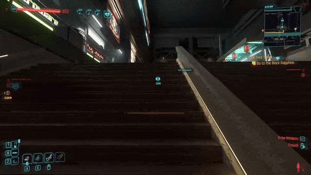
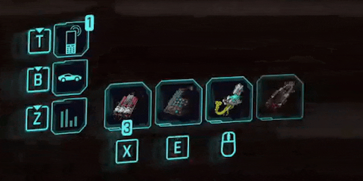
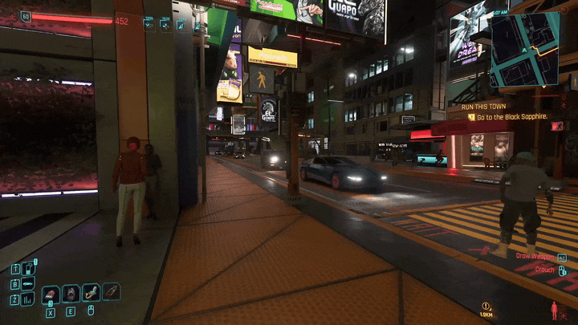

# Gadget Cycle

A tiny [Cyber Engine Tweaks](https://github.com/maximegmd/CyberEngineTweaks) mod for **Cyberpunk 2077 (2.x)**: set a hotkey to cycle the combat-gadget button through your grenades and ability cyberware (Optical Camo, Projectile Launch System), without opening the Alt radial wheel.

In these clips the cycle key is bound to **mouse wheel down**. To free it, wheel down was unbound from *Previous weapon* in the game's settings, using [this mod](https://www.nexusmods.com/cyberpunk2077/mods/11429) to allow leaving that action unbound.

<p align="center"></p>

<p align="center"></p>

## Features

- **Cycle hotkey**: each press puts the next favorite on the combat-gadget button. Throw or activate it with your usual key.
- **Favorites checklist** in the CET overlay. If nothing is ticked, it cycles everything you own.
- **Key lock slider**: ignores repeated presses for a short time (0.35 s by default), so a hard mouse-wheel flick moves one step instead of several.
- **Stays quiet** while a game menu or the CET overlay is open.

## Requirements

- Cyberpunk 2077 2.x (PC)
- [Cyber Engine Tweaks](https://www.nexusmods.com/cyberpunk2077/mods/107) for your game version

## Installation

Download `gadget_cycle.zip` from the [latest release](../../releases/latest).

### Manually

Extract `gadget_cycle.zip` into your Cyberpunk 2077 install folder (the one containing `bin/` and `r6/`).
You should end up with:

```
Cyberpunk 2077/bin/x64/plugins/cyber_engine_tweaks/mods/gadget_cycle/init.lua
```

### Vortex / Nexus Mod Manager

Not supported.

### Amethyst (supported)

1. Install Cyber Engine Tweaks first, if you don't have it.
2. In Amethyst, add `gadget_cycle.zip` as a new mod (install from archive / drag and drop the zip).
3. Enable the mod and deploy, then start the game.

## Usage

1. Load a save and open the CET overlay (default `~`).
2. **Bindings** → set a key for *Cycle favorite grenade / ability*.
3. In the **Gadget Cycle** window, tick your favorites and adjust *Key lock (s)* if needed.
4. Close the overlay and press your key. The gadget icon on the HUD changes.

Setup in the CET overlay: ticking favorites, then binding the cycle key to mouse wheel down.

<p align="center"></p>

Settings are saved to `favorites.json` next to `init.lua`. The favorites list is saved as soon as you tick or untick an item; the slider value is saved when you close the overlay.

## Troubleshooting

- **An ability is missing from the list**: open the Gadget Cycle window, click *Debug: print cyberware to console*, and include the CET console output in an issue.
- **Errors**: copy the error from the CET console into an issue.

## Development

- All code is in `bin/x64/plugins/cyber_engine_tweaks/mods/gadget_cycle/init.lua`. After editing, use *Reload All Mods* in the CET overlay.
- Run the mock self-test: `luajit test_gadget_cycle.lua` (prints `ok` on success).

### Mock self-test

The mod calls game objects (`Game.GetPlayer()`, the equipment and inventory systems, …) that only exist inside Cyberpunk. `test_gadget_cycle.lua` replaces them with small fakes (a made-up inventory, a gadget button that just remembers what was assigned, a toggleable menu flag) and then loads the real `init.lua` against them. It checks:

- presses cycle through grenades and installed abilities, counting duplicate grenade stacks once and skipping uninstalled cyberware and non-gadget items
- a burst of presses within the key lock (a mouse-wheel flick) moves only one step
- presses do nothing while a menu is open, or in the main menu with no player loaded
- only favorites are cycled; if none of the favorites are owned, everything is cycled

It verifies the mod's own logic, not the game: whether the real game calls behave like the fakes can only be checked in-game. The release workflow runs it before publishing, so a change that breaks the logic doesn't get released.
